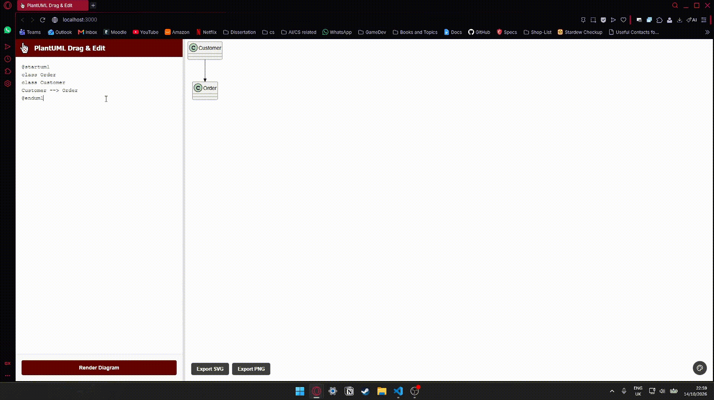

# PlantUML Drag & Edit

A web app for editing PlantUML class diagrams with a draggable layout. Write PlantUML code, render it through a real PlantUML engine, then drag classes and packages around by hand. Runs locally or in Docker. 
**[Click me to try it out!](https://plantuml-drag-and-edit.onrender.com)**



## Table of Contents

| Section | Content |
|---|---|
| [How To Use](#how-to-use) | Rendering, dragging, exporting and colours |
| [Why](#why) | Why this tool exists |
| [How It Works](#how-it-works) | Behind the scenes |
| [Requirements / How to Install](#requirements) | Docker or a direct install |
| [Known Limitations](#known-limitations) | What doesn't work or exist yet |
| [Future Implementations](#future-implementations) | Planned features |

## How To Use

1. Type PlantUML class diagram code (could work with other diagram types, but haven't been explicitly tested) in the textarea (see example pre-filled on load).
2. Click **Render Diagram**.
3. Drag any class box to reposition it. Connector lines and their labels follow.
4. Drag a package's background/border to move it and everything inside it together. Drag an individual class within a package to move just that class.
5. If you drag a class fully outside its package's border, a dashed guide line appears connecting it back to its package for as long as you're dragging it, so you don't lose track of where it belongs. The guide line disappears once you release the mouse and never appears in exported SVGs/PNGs.
6. Use the buttons on the canvas to export the current layout as **SVG** or **PNG** (bottom left), change the **canvas background colour** (bottom right), or change a **package's background colour** with the picker in its corner. The colour picker buttons won't show up when you export
7. Drag the bar between the editor and the canvas to resize the editor.


## Why

I love using PlantUML to create my class diagrams. Not for fun, but for my university courseworks & projects. I'm not a psychopath.
However, as good as PlantUML is, I still find myself spending a boatload of time trying to get the layout to look just perfect.
Let me tell you, it's not a fun process. So I made this tool to be able to easily move around classes/packages and make everything
look just how I want them to look.

It doesn't replace PlantUML's rendering or syntax because that part works great already. It takes PlantUML's own SVG output and adds interactive dragging on top of it.


## How It Works

1. You write `PlantUML` code in the browser and click Render Diagram. The browser sends the code to the Node server with POST /render.
2. The server checks the input, applies the per-IP rate limit and the concurrent-render cap, then starts `java -jar plantuml.jar -tsvg -pipe`. The code goes in through Java’s standard input and the finished SVG comes back through its standard output. PlantUML uses `Graphviz` to work out the layout, and runs in a sandbox with a timeout.
3. The server sends the SVG back and the browser parses it. `g.entity` groups are classes, `g.cluster` groups are packages, `g.link` groups are connectors, and `g.title` is the diagram title. Positions and sizes come from `getBBox()`.
4. Each class, package and the title gets drag handlers. While you drag, mouse coordinates are converted into SVG space and the element moves with an SVG transform. Connecting lines are redrawn live as straight lines between the box borders using rectangle-edge intersection maths, and labels keep their proportional place along the line.
5. Packages carry their contained classes along when dragged. Membership comes from the qualified name (`Account.User` belongs to package `Account`). Dragging a class fully outside its package shows a dashed guide line back to it while you hold it.
6. Export works on a cropped clone of the live SVG, so SVG and PNG files match your dragged layout. The editor text and last render are saved in localStorage.

No PlantUML internals are modified. This project only adds a drag layer on top of its SVG output.

```
Browser                          Node server (Express)                 Java
-------                          ---------------------                 ----
textarea (PlantUML code)
   |  POST /render {code}  --->  validate input
   |                             per-IP rate limit
   |                             concurrent-render cap
   |                             spawn: java -jar plantuml.jar -tsvg -pipe
   |                                        code ------ stdin ------->  PlantUML + Graphviz
   |                                        SVG  <----- stdout -------  lays out the diagram
   |  <--- SVG text -----------  send SVG back
parse SVG -> nodes + edges
attach drag handlers
```

### How Java is used

PlantUML is a Java program, so rendering needs a Java runtime on the server. This project contains no Java code. For every render, the Node server starts a fresh `java -jar plantuml.jar` process, writes your diagram to its standard input, and reads the finished SVG from its standard output (PlantUML's `-pipe` mode, so no temporary files are involved). PlantUML uses **Graphviz** (`dot`) to calculate where boxes and lines go.

This is also why the app can't run on static hosts like Netlify or GitHub Pages: it needs a server with Java and Graphviz installed. The included `Dockerfile` packages all of that.

### How the SVG is parsed

Current PlantUML versions already group each diagram element in the SVG, so the parser (`public/js/diagram/parser.js`) only needs `querySelectorAll`:

| SVG element | Meaning |
|---|---|
| `<g class="entity" id="ent0003" data-qualified-name="Account.User">` | a class / interface / enum |
| `<g class="cluster" id="ent0002" data-qualified-name="Account">` | a package |
| `<g class="link" data-entity-1="ent0006" data-entity-2="ent0016">` | a connector; the two attributes are the ids of the nodes it joins |
| `<g class="title">` | the diagram title (has no `id`, so the app assigns one) |

- **Positions and sizes** come from `getBBox()`, which works for any shape (a class border is a `<rect>`, a package border is a `<path>`).
- **Package membership** is worked out from qualified names: remove the last `.part` of `Account.User` and you get the package name `Account`.
- **Connector labels** (like "books") are remembered as a position along the original line plus a sideways offset, so they keep their place when the line moves.


### Saved in the browser

The editor text and the last rendered (pre-drag) diagram are saved in `localStorage` and restored on page load. Dragged positions are not saved (potential future implementation).

### Project Structure

```
Dockerfile              builds an image with Node, Java, Graphviz and PlantUML
.dockerignore
package.json
server/
  index.js              Express server: /render endpoint, limits, spawns Java
  plantuml.jar          PlantUML (download it yourself locally; Docker fetches it)
public/
  index.html
  styles.css
  assets/
  js/
    main.js             entry point: wires the modules together
    config.js           shared constants
    services/
      storage.js        localStorage (saved code and diagram)
    diagram/
      parser.js         SVG -> nodes and edges
      geometry.js       pure maths (edge intersection, overlap, mouse -> SVG coords)
      edges.js          redraws connector lines, arrowheads and labels
      guides.js         dashed "out of package" guide lines
      packageColor.js   per-package colour picker
      drag.js           drag handling
    ui/
      canvas.js         active SVG, canvas size, background colour
      splitter.js       resizable editor column
      exporter.js       SVG / PNG export
```

The frontend uses native ES modules (`<script type="module">`), so there's no build step.


## Requirements

**Option A: Docker (recommended)**
- Docker Desktop (or any Docker engine)

**Option B: run directly**
- **Node.js** (24 is what the Docker image uses)
- **Java** (JRE 17+)
- **Graphviz**, which PlantUML uses for layout
- **plantuml.jar**: download a current version from [plantuml.com/download](https://plantuml.com/download) and place it at `server/plantuml.jar`. Must be a recent version; older versions (pre-2023ish) produce a different SVG structure this parser doesn't support.

## Run With Docker

```bash
docker build -t plantuml-drag .
docker run --rm -p 3000:3000 plantuml-drag
```

Open `http://localhost:3000`. If port 3000 is taken, use another one, e.g. `-p 3001:3000`, and open `http://localhost:3001`.

The image is based on `node:24-bookworm-slim`, installs Java, Graphviz and fonts, downloads a pinned PlantUML release (the `PLANTUML_VERSION` build argument in the Dockerfile), sets a UTF-8 locale, and runs the server as the unprivileged `node` user (so you don't mess with my app). 

## Run Without Docker

```bash
npm install
node server/index.js
```

Open `http://localhost:3000`. To check PlantUML is set up correctly:

```bash
java -jar server/plantuml.jar -version
```

The output should end with `Installation seems OK. File generation OK` and show a `GraphViz:` line. If your jar is too old, rendered SVGs will contain `<!--MD5=...-->` comments instead of `class="entity"` and the parser won't work.

### Server Settings

Environment variables, all optional:

| Variable | Default | What it does |
|---|---|---|
| `PORT` | `3000` | Port to listen on (hosts like Render set this themselves) |
| `RENDER_TIMEOUT_MS` | `15000` | A render running longer than this is killed (HTTP 504) |
| `MAX_CONCURRENT_RENDERS` | `2` | Max renders at once, since each starts a JVM. Extra requests get HTTP 503 |
| `RATE_LIMIT_MAX` | `30` | Max renders per visitor (by IP) per window. Over the limit gets HTTP 429 |
| `RATE_LIMIT_WINDOW_MS` | `60000` | Length of the rate-limit window |

Example: `MAX_CONCURRENT_RENDERS=4 node server/index.js`. The browser shows the server's message when a render is refused.

### Security notes

- PlantUML runs with `PLANTUML_SECURITY_PROFILE=SANDBOX`, so a diagram can't read files from the server or fetch URLs. As a result, `!include` and remote images don't work.
- Java is started with an argument list rather than a shell command, so diagram text is never interpreted as a command.
- Rate limits and the render cap are kept in memory, per server instance. They stop ordinary abuse, but nothing too serious.

### Deployment Notes

This app needs a host that can run a Docker container (it needs Java and Graphviz next to Node). Static hosts like Netlify can't run it. They only serve static files or short-lived serverless functions with no Java runtime. A Docker-capable host such as Render works: create a Web Service from this repo with the Docker runtime. The host supplies `PORT`, and the server is set to trust one proxy (`trust proxy` = 1) so rate limiting sees each visitor's real IP. If you put another proxy (e.g. Cloudflare) in front, change that number.

## Known Limitations

- **Layout isn't saved.** The code and last render are restored after a refresh, but dragged positions are lost on re-render or refresh.
- **Straight-line edges only.** Dragging discards PlantUML's original curved/routed connector paths in favor of straight lines recomputed live.
- **Requires a recent PlantUML SVG format.** The parser depends on `g.entity` / `g.cluster` / `g.link` elements with `data-qualified-name` and `data-entity-1/2` attributes, introduced in newer PlantUML versions. Diagrams rendered by older PlantUML jars will not parse.
- **Only class/interface/enum + package relationships are diagram-aware.** Sequence diagrams, activity diagrams, etc. are not supported by the drag logic (though PlantUML will still render them as static SVG).
- **No accounts.** Anyone with the link can render diagrams. Nothing is stored on the server.

## Future Implementations
- **Size Buttons.** Allow boxes/classes/packages to be sized up easily
- **Zoom in/out Buttons.**
